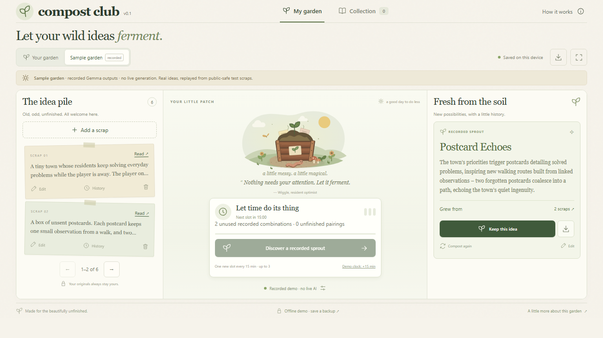

<div align="center">
  <h1>🌱 Compost Club</h1>
  <p><strong>Let your wild ideas ferment.</strong></p>
  <p>A quiet garden for unfinished thoughts. Blend two scraps with local Gemma, keep a new idea, or compost it again.</p>
</div>

<p align="center">
  <a href="https://github.com/drevendev/CompostClub/actions/workflows/quality.yml"></a>
  <a href="LICENSE"></a>
  <a href="#try-the-sample-garden"></a>
</p>

<p align="center">
  <a href="#try-the-sample-garden">Try it locally</a> ·
  <a href="https://drevendev.github.io/CompostClub/">Watch the demo</a> ·
  <a href="https://dev.to/drevendev/let-your-wild-ideas-ferment-a-quiet-garden-powered-by-local-gemma-1c0o">Read the DEV article</a> ·
  <a href="docs/RUNNING.md">Live local AI</a> ·
  <a href="docs/MODEL_EVAL.md">Model evidence</a> ·
  <a href="https://github.com/drevendev/CompostClub/issues?q=is%3Aissue+is%3Aopen+label%3Areview">Known issues</a> ·
  <a href="CONTRIBUTING.md">Contribute</a>
</p>



_Actual Chromium capture of the compact sample workspace. The sample pairs six fictional scraps with unchanged local Gemma recordings. Text alternative: add a scrap on the left, let a pairing grow in the center, then inspect its two sources and keep or recompost the result on the right._

The [published DEV article](https://dev.to/drevendev/let-your-wild-ideas-ferment-a-quiet-garden-powered-by-local-gemma-1c0o) follows real local Gemma results from public project summaries. The [49.93-second English video](https://drevendev.github.io/CompostClub/?v=07c202852017) shows Echo Cartography and recomposting. Newer idea branches and optional Sentry tracing are illustrated separately in the article. [Publication materials, captions and credits](docs/DEV_PUBLICATION.md).

## Manual external generation preview

The 0.2.0-rc.4 candidate adds an explicitly selected manual connection to **official Claude Code using your own Claude subscription**, plus optional Groq BYOK. Choose a provider in desktop Settings, preview the exact selected context and authorize one bounded job. There is no remote background generation or automatic fallback. Local storage, local Ollama and the recorded sample remain available independently. No account, model or CLI is installed for you.

[Setup, privacy, subscription login, optional Groq key and acceptance status](docs/PROVIDER_PATCH.md). This is an experimental source/PR candidate, not a stable quality claim or an installed owner upgrade. Local Gemma RU issues remain open.

## Use the local desktop candidate

The experimental **0.2.0-rc.1 Coherent Gardens** Windows candidate adds named gardens, preserved full originals and source preparation, explicit references, rich generation with a fallible semantic checker, approved feedback preferences, deliberate growth and opt-in cross-garden exchange. An application window and tray control a local SQLite workspace and an explicitly selected installed Ollama/model. It starts paused; manual jobs have separate explicit authorization. Pause drains owned work and releases its model process before reporting success.

Open the supplied portable application shortcut, or build with `npm run desktop:package`. Follow the [RC setup, migration and rollback guide](docs/COHERENT_GARDENS_RC.md) and [acceptance record](docs/COHERENT_GARDENS_ACCEPTANCE.md). No weights or personal data are bundled. **Usefulness is not promoted:** the frozen local comparison produced 0 screened/displayable candidates in 16 cases, and owner review is pending future real-card trials. Filtered drafts and original failures remain inspectable. The actual 7–14 day observation is still pending. The browser instructions below describe the separate smaller v0.1 application.

The [card contract for repositories, Obsidian and Codex](docs/CARD_CONTRACT.md) specifies stable IDs, exact revisions, originals, model proposals, human decisions and previewed synchronization. It documents adapter boundaries; it does not enable automatic remote synchronization.

Codex can [control the running desktop through its authenticated local operator interface](docs/OPERATOR.md): status, settings, review, jobs, pause/resume and safe Exit, without GUI automation or editing a live database. The portable includes `operator.mjs`. An explicit operator preset can raise the default three-credit capacity to ten.

## Try the sample garden

Requires **Node 24, npm 11**, Git and a recent browser. From a terminal:

```sh
git clone https://github.com/drevendev/CompostClub.git
cd CompostClub
npm ci
npm run dev
```

Open the printed `http://127.0.0.1:5173` URL. Select **Try the sample garden**, then **Discover a recorded sprout**. A recorded idea appears with its exact source fragments. Select **Keep this idea**, open **Collection**, then reload: your keeper stays.

This first run needs no account, API key or model download. Dependency installation contacts npm. The sample is explicitly labelled **recorded Gemma outputs · no live generation**. A changed or unrelated input never receives an unrelated canned answer.

**v0.1 is an experimental local application.** Source and a [video walkthrough](https://drevendev.github.io/CompostClub/) are public; the interactive application has not been deployed. See the [known issues](https://github.com/drevendev/CompostClub/issues?q=is%3Aissue+is%3Aopen+label%3Areview) before relying on saves; export backups regularly. The application [Pages workflow](.github/workflows/pages.yml) requires a separate manual launch and would replace the current video page.

## What grows here

- Editable Unicode scraps, original illustrations and Wiggle the worm.
- One welcome pairing, then a slot every 15 minutes, capped at three. Browser time away earns slots; desktop background generation additionally requires explicit enablement and obeys its own limits.
- Deterministic pair selection, source revisions, exact quotes and immutable parent snapshots.
- **History** on each scrap preserves its submitted raw text across edits, including before the first sprout. Up to 100 saved revisions share the validated backup budget; earlier missing text in legacy backups is disclosed.
- Keep, edit, recompost, Markdown export, versioned JSON backup and validated restore.
- **Tend this idea** develops a kept personal idea through one local-model proposal at a time. Review, edit, accept or reject; accepted branches keep their parent links. Acceptance spends one slot; rejection, cancellation and failure keep it.
- Revisit every discovery through **Collection → All discoveries**, including results you have not kept. Retry an unfinished pairing explicitly after reload while its sources remain unchanged.
- IndexedDB persistence, competing-tab checks and a visible memory-only fallback.
- A self-contained offline HTML sample, without model weights or startup network dependencies.

## Three ways to blend

| Mode          | What it does                                                                       | Current evidence and limits                                                                                    |
| ------------- | ---------------------------------------------------------------------------------- | -------------------------------------------------------------------------------------------------------------- |
| Sample garden | Replays seven unchanged Gemma 3 4B recordings for exact public inputs and language | Works without a model; visibly recorded throughout UI and exports                                              |
| Local Ollama  | Runs Gemma 3 1B or 4B on your device through a loopback bridge                     | Real local calls tested. 4B passed 24/24 structural checks; usefulness review is pending. 1B has weaker output |
| Browser AI    | Opt-in Gemma 3 270M / 1B ONNX download, WebGPU and a worker                        | Both really ran; neither passed the contract in the small EN/RU smoke set. Experimental                        |

For live generation, start with the [Ollama setup](docs/RUNNING.md#run-live-local-gemma). Downloads, hardware requirements, failure transcripts and the distinction between structural validity and a useful idea are documented in [model evaluation](docs/MODEL_EVAL.md). Failed inference is never replaced by an invented success.

## Data stays with the garden

Scraps and results live in browser IndexedDB, the desktop's local SQLite workspace or explicit exports. There are no Compost Club end-user accounts, telemetry by default or external fonts. Optional manual external generation uses the owner’s separately authenticated provider after context consent; no paid plan is activated by the application. Optional operator-only Sentry metadata tracing is off by default; see [setup and removal](docs/OPTIONAL_SERVICES.md). Render and Entire were declined and are not used. Model output and user input render as text.

Ollama mode uses a server bound to `127.0.0.1`, forwarding to a fixed loopback Ollama address. Browser AI contacts the disclosed Hugging Face/CDN endpoints only after download consent; ideas are processed on the device. Model weights carry separate terms and are excluded from Git. The [architecture](docs/ARCHITECTURE.md) describes the boundaries and current limitations.

## Check and explore

From the repository root:

```sh
npm run verify
npm run build
npm run package:single
```

`verify` runs strict TypeScript, ESLint, unit tests, HTTP/Sentry regressions, desktop/storage/export/packaging diagnostics and formatting. `package:single` writes `release/compost-club-preview.html`, a recorded offline demo below 2 MiB. [Repository CI](.github/workflows/quality.yml) also checks documentation links, the production sample under a Pages-style subpath, [eight recovery scenarios](docs/RECOVERY.md#regression-verification) and twenty-four P1/workflow/stability/layout/growth scenarios in Chromium. Run `npm run test:recovery` and `npm run test:p1` after building both variants. Diagnostic stubs and synthetic pairing indexes are explicitly labelled and never counted as live-model evidence. These checks do not download models or certify live model quality. The [stability acceptance receipt](evidence/stability-verification.json) records a historical sample/offline run; its live-inference status is `not-run`. The [capacity diagnostic](evidence/pairing-capacity.json) measures the pure picker on 200 fictional sources and 19,900 attempts, not model speed.

Ready slots are time credits; they do not create extra combinations of the same two sources. The garden shows unused combinations separately. When they run out, your slots remain available while you add a scrap, edit a source or recompost a result. At the 200-source cap, the next action opens an existing source for editing when pairing-history space remains. A full pairing history requires explicit cascade review before a new key can be started; existing failed pairs can still be retried.

The earlier [local acceptance receipt](evidence/verification.json) records seven Chromium journeys, including real Ollama inference. Live e2e tests require an explicitly installed model and running bridge; see [running and verification](docs/RUNNING.md#verify-and-package). Unit/CI checks, local browser tests and model evaluation are separate evidence.

| Next question                                         | Start here                                                                                                             |
| ----------------------------------------------------- | ---------------------------------------------------------------------------------------------------------------------- |
| How do I run live AI or make the offline demo?        | [Running and packaging](docs/RUNNING.md)                                                                               |
| What talks to what?                                   | [Architecture and data boundaries](docs/ARCHITECTURE.md)                                                               |
| Which model tests passed or failed?                   | [Model evaluation](docs/MODEL_EVAL.md)                                                                                 |
| What was tested locally?                              | [Acceptance record](docs/ACCEPTANCE.md)                                                                                |
| How do limits and recovery work?                      | [Save limits and recovery](docs/RECOVERY.md)                                                                           |
| What still needs work?                                | [Issues](https://github.com/drevendev/CompostClub/issues) and [roadmap](docs/ROADMAP.md)                               |
| How do I use the desktop experiment and Codex export? | [Desktop guide](docs/LOCAL_DESKTOP_RUNNING.md) and [implementation/owner-pilot status](docs/LOCAL_EXPERIMENT_TASKS.md) |
| How can I contribute or get help?                     | [Contribution guide](CONTRIBUTING.md)                                                                                  |
| What changed?                                         | [Changelog](CHANGELOG.md)                                                                                              |
| How would hosting work?                               | [Deployment preparation](docs/DEPLOYMENT.md)                                                                           |

## Contribute and reuse

Created by **Dreven (Aleksei Bogun)**, solo developer.
[GitHub](https://github.com/drevendev) · [Telegram](https://t.me/Drevenoise) ·
[itch.io](https://drevengames.itch.io/) · [X](https://x.com/drevendev) · [DEV](https://dev.to/drevendev).

The [platform adoption record](docs/PLATFORM_ADOPTION.md) explains the reusable desktop
standards extracted from this app and the selected Game Development Platform practices.

Small fixes, reproducible bug reports and accessibility feedback are welcome. Read [CONTRIBUTING.md](CONTRIBUTING.md) for setup, review expectations and the boundary around private data. Public documentation is maintained in English; English or Russian issue reports are welcome.

The repository presentation follows [BeautifulRepo's visitor journey](https://github.com/drevendev/BeautifulRepo): purpose → evidence → first success → trust → contribution. No third-party branding or product assets were copied.

Code and original project assets: [MIT](LICENSE). Model weights: separate [Gemma Terms](https://ai.google.dev/gemma/terms). Dependency acknowledgements and full licence texts: [third-party notices](THIRD_PARTY_NOTICES.md).
