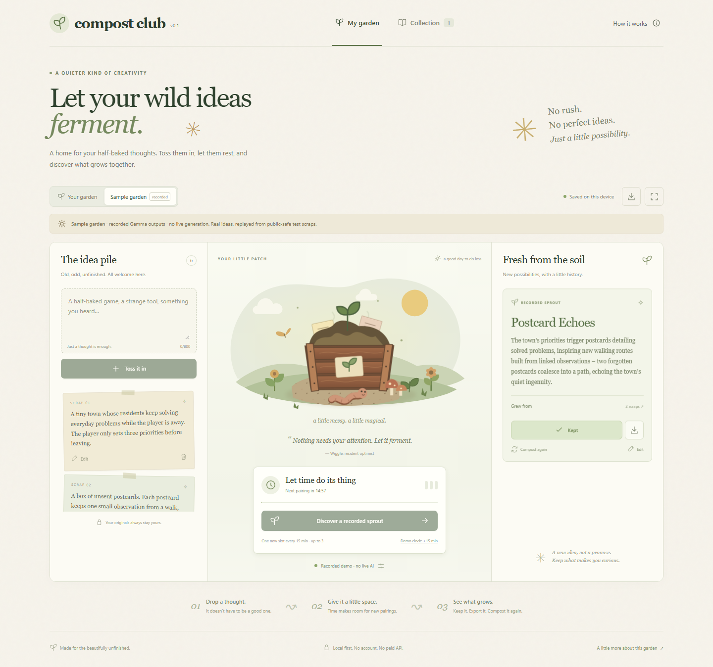

<div align="center">
  <h1>🌱 Compost Club</h1>
  <p><strong>Let your wild ideas ferment.</strong></p>
  <p>A quiet garden for unfinished thoughts. Blend two scraps with local Gemma, keep a new idea, or compost it again.</p>
</div>

<p align="center">
  <a href="https://github.com/drevendev/CompostClub/actions/workflows/quality.yml"></a>
  <a href="LICENSE"></a>
  <a href="#try-the-sample-garden"></a>
</p>

<p align="center">
  <a href="#try-the-sample-garden">Try it locally</a> ·
  <a href="docs/RUNNING.md">Live local AI</a> ·
  <a href="docs/MODEL_EVAL.md">Model evidence</a> ·
  <a href="https://github.com/drevendev/CompostClub/issues?q=is%3Aissue+is%3Aopen+label%3Areview">Known issues</a> ·
  <a href="CONTRIBUTING.md">Contribute</a>
</p>



_Actual Chromium capture, 20 October 2026, from the v0.1 implementation included in the initial commit. The sample pairs six fictional scraps with unchanged local Gemma recordings. Text alternative: add a scrap on the left, let a pairing grow in the center, then inspect its two sources and keep or recompost the result on the right._

## Try the sample garden

Requires **Node 24, npm 11**, Git and a recent browser. From a terminal:

```sh
git clone https://github.com/drevendev/CompostClub.git
cd CompostClub
npm ci
npm run dev
```

Open the printed `http://127.0.0.1:5173` URL. Select **Try the sample garden**, then **Discover a recorded sprout**. A recorded idea appears with its exact source fragments. Select **Keep this idea**, open **Collection**, then reload: your keeper stays.

This first run needs no account, API key or model download. Dependency installation contacts npm. The sample is explicitly labelled **recorded Gemma outputs · no live generation**. A changed or unrelated input never receives an unrelated canned answer.

**v0.1 is an experimental local application.** Source is public; a hosted website has not been deployed. See the [known issues](https://github.com/drevendev/CompostClub/issues?q=is%3Aissue+is%3Aopen+label%3Areview) before relying on saves; export backups regularly. The [Pages workflow](.github/workflows/pages.yml) requires a separate manual launch.

## What grows here

- Editable Unicode scraps, original illustrations and Wiggle the worm.
- One welcome pairing, then a slot every 15 minutes, capped at three. Time away earns slots; it never generates outputs in the background.
- Deterministic pair selection, source revisions, exact quotes and immutable parent snapshots.
- Keep, edit, recompost, Markdown export, versioned JSON backup and validated restore.
- IndexedDB persistence, competing-tab checks and a visible memory-only fallback.
- A self-contained offline HTML sample, without model weights or startup network dependencies.

## Three ways to blend

| Mode          | What it does                                                                       | Current evidence and limits                                                                                    |
| ------------- | ---------------------------------------------------------------------------------- | -------------------------------------------------------------------------------------------------------------- |
| Sample garden | Replays seven unchanged Gemma 3 4B recordings for exact public inputs and language | Works without a model; visibly recorded throughout UI and exports                                              |
| Local Ollama  | Runs Gemma 3 1B or 4B on your device through a loopback bridge                     | Real local calls tested. 4B passed 24/24 structural checks; usefulness review is pending. 1B has weaker output |
| Browser AI    | Opt-in Gemma 3 270M / 1B ONNX download, WebGPU and a worker                        | Both really ran; neither passed the contract in the small EN/RU smoke set. Experimental                        |

For live generation, start with the [Ollama setup](docs/RUNNING.md#run-live-local-gemma). Downloads, hardware requirements, failure transcripts and the distinction between structural validity and a useful idea are documented in [model evaluation](docs/MODEL_EVAL.md). Failed inference is never replaced by an invented success.

## Data stays with the garden

Scraps and results live in your browser's IndexedDB or explicit exports. There are no accounts, telemetry, cloud generation, external fonts or paid APIs. Model output and user input render as text.

Ollama mode uses a server bound to `127.0.0.1`, forwarding to a fixed loopback Ollama address. Browser AI contacts the disclosed Hugging Face/CDN endpoints only after download consent; ideas are processed on the device. Model weights carry separate terms and are excluded from Git. The [architecture](docs/ARCHITECTURE.md) describes the boundaries and current limitations.

## Check and explore

From the repository root:

```sh
npm run verify
npm run build
npm run package:single
```

`verify` runs strict TypeScript, ESLint, 63 unit tests and formatting. `package:single` writes `release/compost-club-preview.html`, a recorded offline demo below 2 MiB. [Repository CI](.github/workflows/quality.yml) also checks documentation links, the production sample under a Pages-style subpath, [eight recovery scenarios](docs/RECOVERY.md#regression-verification) and six P1 transport/storage scenarios in Chromium. Run `npm run test:recovery` and `npm run test:p1` after building both variants. Diagnostic stubs are explicitly labelled and never counted as live-model evidence. These checks do not download models or certify live model quality.

The earlier [local acceptance receipt](evidence/verification.json) records seven Chromium journeys, including real Ollama inference. Live e2e tests require an explicitly installed model and running bridge; see [running and verification](docs/RUNNING.md#verify-and-package). Unit/CI checks, local browser tests and model evaluation are separate evidence.

| Next question                                  | Start here                                                                               |
| ---------------------------------------------- | ---------------------------------------------------------------------------------------- |
| How do I run live AI or make the offline demo? | [Running and packaging](docs/RUNNING.md)                                                 |
| What talks to what?                            | [Architecture and data boundaries](docs/ARCHITECTURE.md)                                 |
| Which model tests passed or failed?            | [Model evaluation](docs/MODEL_EVAL.md)                                                   |
| What was tested locally?                       | [Acceptance record](docs/ACCEPTANCE.md)                                                  |
| How do limits and recovery work?               | [Save limits and recovery](docs/RECOVERY.md)                                             |
| What still needs work?                         | [Issues](https://github.com/drevendev/CompostClub/issues) and [roadmap](docs/ROADMAP.md) |
| How can I contribute or get help?              | [Contribution guide](CONTRIBUTING.md)                                                    |
| What changed?                                  | [Changelog](CHANGELOG.md)                                                                |
| How would hosting work?                        | [Deployment preparation](docs/DEPLOYMENT.md)                                             |

## Contribute and reuse

Small fixes, reproducible bug reports and accessibility feedback are welcome. Read [CONTRIBUTING.md](CONTRIBUTING.md) for setup, review expectations and the boundary around private data. Public documentation is maintained in English; English or Russian issue reports are welcome.

The repository presentation follows [BeautifulRepo's visitor journey](https://github.com/drevendev/BeautifulRepo): purpose → evidence → first success → trust → contribution. No third-party branding or product assets were copied.

Code and original project assets: [MIT](LICENSE). Model weights: separate [Gemma Terms](https://ai.google.dev/gemma/terms). Dependency acknowledgements and full licence texts: [third-party notices](THIRD_PARTY_NOTICES.md).
