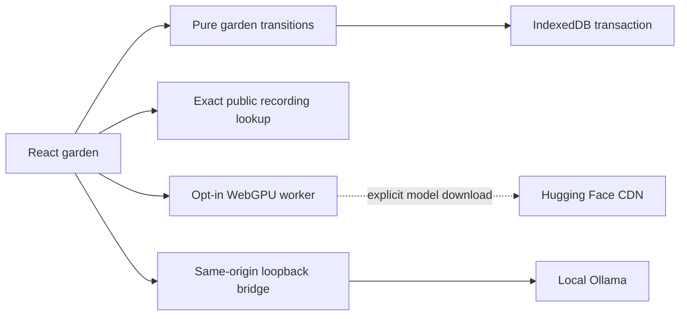

# Architecture and data boundaries

Compost Club is a React/TypeScript application built with Vite. It can run as a static sample, a local application with an Ollama bridge, or an explicitly experimental browser inference client.

Text alternative: the UI applies pure garden transitions and saves them to IndexedDB. A generation request uses one of three providers: exact recorded fixtures, a browser worker, or a same-origin loopback bridge to local Ollama. Only the opt-in browser model download contacts the model CDN.

## Source map

| Location                              | Responsibility                                                                                   |
| ------------------------------------- | ------------------------------------------------------------------------------------------------ |
| `src/domain/garden.ts`                | Scrap revisions, idle accounting, deterministic pairs, result commit, deletion graph and backups |
| `src/application/storage.ts`          | IndexedDB transactions, revision conflicts and explicit memory fallback                          |
| `src/inference/contract.ts`           | Prompt, schema, source fragments and model-output validation                                     |
| `src/inference/provider.ts`           | Recording lookup, Ollama transport and worker lifecycle                                          |
| `src/inference/browser.worker.ts`     | Transformers.js / ONNX WebGPU model execution                                                    |
| `src/App.tsx`, `src/ui/`              | Accessible controls, garden illustration and interaction state                                   |
| `server/index.mjs`                    | Static assets and the loopback Ollama bridge                                                     |
| `fixtures/public/`, `evidence/model/` | Fictional inputs and actual raw model receipts                                                   |

## Persistence and failure

Personal and sample gardens use separate records in the `compost-club-v1` IndexedDB database. A transaction compares the persisted revision before writing. Web Locks coordinate a writer where available. An unavailable database produces a visible in-memory warning; users must export before closing.

A successful result stores its output, immutable source snapshots, consumed pair and spent slot together. Failed/cancelled generations retain their slot. Pending inference is never resumed from a backup. Source text and model output render as text, not HTML.

Writes and portable backups share validation and the 2 MiB pretty-printed JSON budget. Original scrap text is capped at 8 KiB without silent truncation. Unreadable records open a [recovery screen](RECOVERY.md): the original can be downloaded, and a confirmed restore atomically retains it under `recovery:personal` or `recovery:sample` before replacing the active garden. These keys hold the most recent recovery copy separately from normal garden backups. A stale recovery preview cannot overwrite a changed record.

The first review also found gaps in retry durability and UI state; see [review issues](https://github.com/drevendev/CompostClub/issues?q=is%3Aissue+label%3Areview). The bridge is intended for local use and has not received a production security audit.

## Build boundary

`npm run build` creates relative-path static assets. Static hosts cannot run Ollama. `npm run package:single` embeds the recorded sample into one HTML file, disables live generation and includes dependency licence texts. File-origin storage can change when the file is renamed or moved; JSON export is the portable data route.

`scripts/release.mjs` uses an explicit source allowlist. Private briefings, attachments, owner archives, local experiments, model weights, binaries and raw runner reports are excluded from source archives. Git publication is separately audited with a staged-file allowlist.
