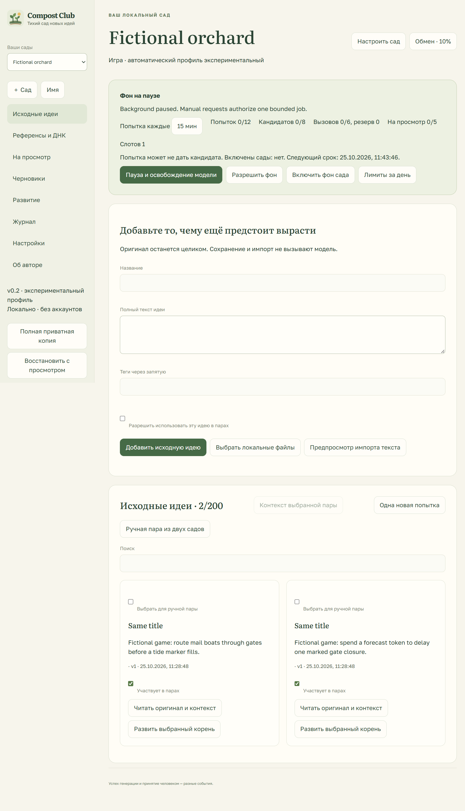

# Coherent Gardens — 0.2.0-rc.1

This is an experimental Windows release candidate implementing the [v0.2 contract](NEXT_RELEASE_SPEC.md). It is available for local owner trials. **Creative usefulness has not passed the promotion gate.** A draft PR or portable package does not imply a GitHub Release, deployment or competition submission. See the [acceptance record](COHERENT_GARDENS_ACCEPTANCE.md) for the negative model result and remaining human decisions.



Text alternative: select a named garden at the top, inspect its rhythm and compute allowances, add complete originals, and open each source's preparation and history. Participation and cross-garden permissions are explicit. Errors and waiting reasons stay visible.

## Start and preserve rollback

Use the supplied portable `CompostClub.exe`, or build with Node 24/npm 11:

```sh
npm ci
npm run desktop:package
```

No model, inference executable or personal workspace is bundled. In Settings, explicitly select an existing Ollama executable and model directory containing Gemma 3 1B or 4B. The RC uses its own loopback process; it does not take over a shared Ollama service. There are no model downloads. Manual actions work while the scheduler is paused. A new launch, restart or wake stays paused.

Before the first RC launch, Exit the previous application and keep its portable folder. Make an independent copy of the complete data directory while the application is closed, and export a full private backup. The migration transaction also retains a validated pre-schema-3 rollback envelope before changing the workspace. Original IDs, texts, decisions, raw evidence and legacy growth remain recoverable. Migration makes one **My Garden**, with unknown type until explicitly selected; it does not infer topics or reference facts. Old successful results remain labelled unscreened under the current contract. Existing limits are preserved rather than silently changed to new defaults.

Schema 3 cannot be opened with the old executable. For rollback, Exit the RC, keep its complete data directory separately, and restore the independent pre-upgrade directory copy before launching the previous executable. Alternatively use the previous executable with a separate clean data directory and its validated v2 rollback envelope. Do not replace a running SQLite database, mix WAL files from different copies, or pass a schema-3 backup to an old binary. If validation fails, preserve the rejected files and use the original executable/copy; the application does not invent missing history.

## Prepare sources without a model

Create up to four named gardens and select a type/objective. Add a complete original or import explicitly selected UTF-8 files. Import previews exact duplicates, similar titles and distinct contents; choose link, skip or a new copy. File originals and bytes remain preserved. Editing adds a revision. Reading the original never starts inference.

Open a source to inspect the complete original, immutable history, prepared model text, exact UTF-8 spans, omissions and selected context. Markdown/URL normalization affects only the model representation. Approve source facets and aliases explicitly; suggested DNA is a proposal. Alias corrections have an explicit source/garden scope and never rewrite the original. Essential omitted context blocks the job instead of silently shortening it.

A reference record separates its name/link, supplied property, intended difference, evidence spans and support status. A title or URL alone supplies no mechanic. Saving a link never fetches it. Only safe HTTP(S) reference links can open externally. Reference/source text is untrusted text, including any apparent instructions or HTML.

The inference context is bounded to 4,096 tokens with generation output at most 900 and checker output at most 480. When a matching tokenizer is unavailable, preparation uses a conservative **UTF-8 byte upper bound**, reserving output and framing space. That bound is not an observed token count. Exact prompts, schemas, limits and actual provider observations are retained per dispatch.

## Generate, inspect and decide

A manual pairing starts one bounded job without enabling background operation. Generation can return a rich candidate or an explicit `no_blend`, `no_growth` or `needs_context`. A candidate is retained before a separate, fallible evidence-based check. There is at most one format repair shared across both stages: two normal calls, three at most. A terminal negative skips checking. Timeout, cancellation and refusal preserve original responses; no recording replaces a failed live answer.

Open pending review or filtered drafts to read the full mechanism, example, contribution from each parent, references, uncertainties and assessment. Keep, develop, reject and defer remain human decisions. A structurally valid filtered draft can be accepted explicitly with an override reason; that remains labelled **accepted despite screening**. A checker pass does not prove a good game. Raw/model and human revisions stay distinct. A selected revision can be edited, rechecked or explicitly revised by the model without silently replacing its earlier evidence.

Reviews save reasons and free text verbatim. Select reviews when requesting a preference proposal, then approve/edit scoped preference clauses separately. Only approved clauses enter subsequent selected context. This is prompt context, not model retraining. Unselected notes are not sent to the model.

## Rhythm, budgets and exchange

New workspace defaults are a 15-minute interval, 12 attempts, 8 new candidates, 24 model calls per day and 5 pending reviews. Intervals of 15/30/60/120/240 minutes are selectable. Each garden accrues up to three credits; one global compute owner runs at a time. The UI distinguishes attempts, failed jobs, semantic outcomes, shown candidates and human decisions. Increasing a limit cannot guarantee more useful results.

Charges are durable immediately before dispatch. Repairs, DNA and preference calls share the global allowance. A blend reserves enough for both stages. A failed/negative/cancelled blend keeps its credit. A displayed candidate, consumed pair and credit commit together once. Growth proposals hold a credit until acceptance or rejection. Day accounting uses the saved timezone and resists clock rollback; restore cannot refund dispatched calls. Review backpressure and repeated operational failures stop unattended work.

Background work requires explicit enablement for each garden and Resume. Closing the window keeps an enabled scheduler in the tray; **Pause** aborts/drains the current stage and releases owned compute. **Exit** additionally persists shutdown preparation and terminates the app. Persistence/export attention can block an unsafe Exit; resolve or explicitly back up/clean up the indicated evidence, then retry. A saved shutdown event is not a claimed OS exit timestamp.

Exchange starts off. The donor separately permits donating participating sources; a receiver selects permitted donors and a probability. The enable dialog may suggest 10%, activated only after confirmation. Automatic work persists one seeded draw and route. At 0% no donor content is inspected; at 100% one local and one donor source are selected. Ten percent is a per-attempt probability. A blocked route stays as a waiting plan, without reroll or hidden fallback. Explicit cancellation/manual local override is available and recorded. Manual cross selection is labelled manual. Consent, source versions and policy are checked before each stage and commit. Revocation stops affected pending work; existing immutable disclosed snapshots remain.

## Growth and recovery

Choose an accepted idea or deliberate source root, a growth direction and a question. Inspect a proposal's preserved core, delta, changed assumption and parent links before accepting it. Three pending proposals per parent are the maximum. Accepted branches and alternatives appear in an outline; comparison keeps full revisions accessible. A proposed paper test is labelled unperformed. Recomposting explicitly makes a new source with ancestry; nothing self-feeds automatically. Evolution Lab population selection/mutation is the separately preserved [subsequent milestone](IDEA_EVOLUTION_SPEC.md).

Full private backups include originals, receipts, preferences, graph and decisions. Validate a backup before replacement. Restore starts paused with exchange disabled, retains installation-owned paths and keeps spent call accounting. Imported evidence is labelled imported, not upgraded into locally observed inference. Single-garden recovery requires a dependency preview including donor snapshots; otherwise use a clearly non-restorable redacted reading export.

Codex export writes an immutable verified Markdown/JSON snapshot plus an atomic current pointer. Its analysis area remains independently owned. The default scope is kept work; all candidates and filtered drafts are separate choices. Reading exports omit hidden originals, comments and model packs by default and disclose generated/imported/recorded/human-edited status. Full evidence is a separate private backup. Deletion and cleanup show cascade/dependency and retained-copy previews before confirmation; no hidden pruning creates space.

Supported count limits are 4 gardens, 200 sources per garden/800 total, 1,000 retained documents (1 MiB each, 20/import), 1,000 candidates/growth nodes/jobs each, and depth 32. All retained originals also share a 32 MiB structured workspace cap. Raw receipts: 3,000/128 MiB; full backup: 192 MiB; retained backups: 64/256 MiB. Counts do not guarantee every maximum-sized object fits simultaneously. Capacity refusal preserves existing data.

## Browser and recorded compatibility

The browser/standalone remains the smaller v0.1 IndexedDB application. It does not acquire a desktop scheduler or silently migrate browser storage. The standalone HTML contains exact labelled public recordings and no model weights or startup network dependencies. Both browser WebGPU model sizes remain experimental after their original EN/RU contract failures. Superseded/cancelled model loads cannot install a late worker.

Local inference stays on the device. There are no end-user accounts, cloud inference, paid services or analytics. Optional operator-only metadata tracing is independently removable and off by default; see [optional services](OPTIONAL_SERVICES.md). Fonts and artwork are local with bundled licences. Private owner inputs, inference tools, model weights and raw acceptance workspaces are excluded from the reviewed source archive.
