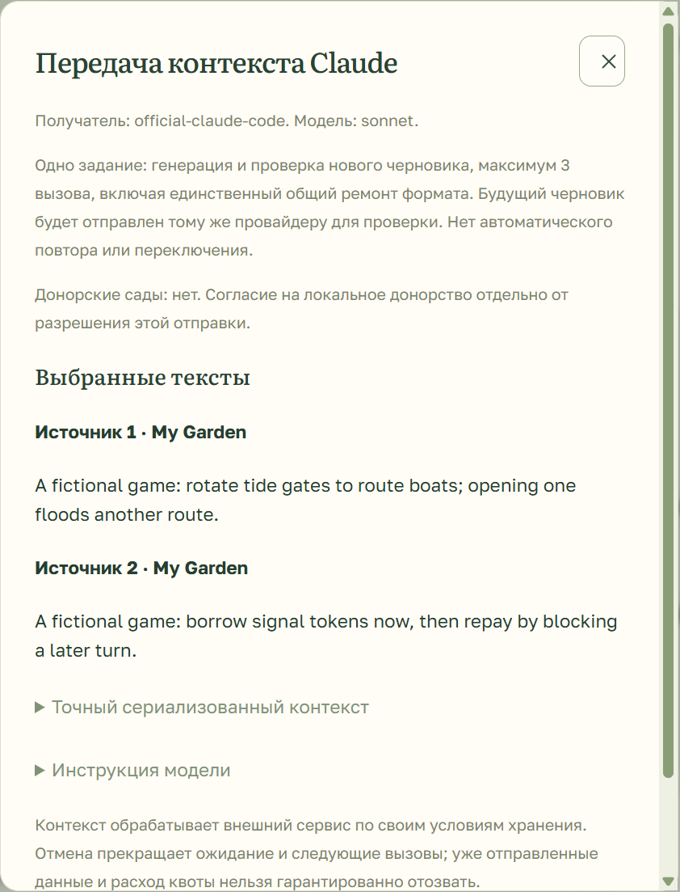

# Provider patch acceptance · 0.2.0-rc.5

Experimental candidate verified on 28 October 2026. Installed official Claude Code is the owner-selected connection. Genuine bounded results below supersede the earlier zero-call status without replacing earlier receipts. Haiku format acceptance and owner usefulness remain open; no stable release or personal installation upgrade is claimed.

## Genuine subscription evidence

The already installed official Claude Code **2.1.259** was selected in the existing isolated preview. Its real protected setup-token passed a no-generation authentication check. No client/model update, API-key billing switch or personal installation replacement occurred.

The new protocol is frozen in `fixtures/public/claude-model-acceptance.json`: one fictional RU pair with six districts, two borrowed signal tokens, mandatory flooding duration, repayment/action loss and no new loan before repayment. The baseline allowed one attempt per Haiku/Sonnet/Opus and at most nine cumulative CLI stage calls. It used six:

| Requested alias | Reported model              | Calls | Result                                                                    |
| --------------- | --------------------------- | ----- | ------------------------------------------------------------------------- |
| Haiku           | `claude-haiku-4-5-20251001` | 2     | Both responses had an outer JSON Markdown fence; no card, credit retained |
| Sonnet          | `claude-sonnet-5`           | 2     | One screened committed proposal                                           |
| Opus            | `claude-opus-5`             | 2     | One screened committed proposal                                           |

Manual reading of the Sonnet/Opus cores and examples found the declared counts, costs and triggers present. Proposed extra mechanics remain hypotheses. Model screening is fallible and is not owner usefulness approval.

After deterministic original-preserving wrapper compatibility and diagnostic tests, one separately recorded corrective Haiku regression used two more calls. JSON then parsed, but `interaction` exceeded the declared 240-code-point bound (340 then 403); a repaired contribution also exceeded its bound. No card was created and the credit stayed available. Both failed attempts and exact originals are retained. **Eight cumulative calls; stop.** The original baseline is not overwritten or claimed to pass. #97 tracks wrapper compatibility; #99 retains the negative length/quality result. All three models remain selectable; Haiku creative-format acceptance is not claimed.

An initial evaluation bootstrap failed before any model call because its fresh Windows crypto profile lacked the source profile key. Keeping protected `Local State` metadata with the isolated profile before Electron readiness restored decryption without plaintext token handling. The bootstrap failure remains retained (#98).

The existing operator-approved Compost Club Sentry configuration accepted **26 baseline + 10 corrective metadata envelopes**. This proves ingest acknowledgement, not a new stored-dashboard-event inspection. Actual SDK-envelope sentinel tests exclude prompt/source/output/raw-error/token/account/machine fields; automatic integrations/logs are disabled and IP is explicitly anonymized. A deterministic filter correction retains the observed major-version model IDs. Traces do not certify semantic usefulness or exact server billing.

The older 36-call matched RU/EN/adversarial matrix has not run. These limited successes do not close #82/#83, Haiku #99 or owner usefulness. The PR remains draft.

## RC5 verification

- Full verify: **176 unit + 85 desktop/process/storage/operator + 4 bridge/privacy + 1 packaging tests**, zero skips; TypeScript, ESLint and formatting passed.
- Model pinning across both stages, consent invalidation, reopen, connection-check races and exact-original JSON-fence handling passed.
- Throwing or indefinitely pending monitoring, broken setters and omitted callbacks cannot repeat inference, bypass validation or prevent completion. Invalid/disabled optional monitoring configuration leaves the application usable.
- Exact final portable `8cf873208b5b3e986931a83147d4bd1c4404dd4e06ae5e16371d617ed016a0b2` passed hidden Chromium consent/IPC/OS-encryption/model-picker/narrow-layout checks. A separate check on the restored owner preview confirmed the protected token, real connection state `ready` with CLI 2.1.259, monitoring enabled, unchanged originals and zero added creative calls. Hidden-window tests avoid Windows screen control and do not claim new visible-window screenshots. An initial locator-screenshot attempt on a hidden window timed out; it is retained as a failed diagnostic, not counted as a pass.
- Final build/recorded HTML/source ZIP/current-file/portable identities are verified in the delivery receipt. No private profile, credential, operator DSN, generated raw receipt or crypto metadata enters the reviewed source selection or portable application contents.

## Historical RC4 evidence

RC4 passed 176 unit + 73 desktop + 3 bridge + 1 packaging tests and 36 Chromium recovery/P1/sample-offline scenarios. Pages-subpath/worker/WASM smoke passed. Its exact portable covered consent, repeated dismissal, 430px/200%/forced colors, actual Windows encryption of fictional credentials, zero renderer HTTP/errors and preserved fictional originals.

The Windows-launch regression (#93) reproduced cache errors in the second direct executable process while the existing writer stayed healthy. The old show/focus handler did restore a minimized window in the controlled test, so missing explicit restore is not claimed as the proven explanation for the owner's earlier minimized state. The corrected launcher/shortcut reused the existing authenticated writer and verified visible/restored/rendered readiness. Cold, minimized, tray-hidden and concurrent launch cases passed without cache deletion or ACL changes. A direct second executable launch can still reproduce Chromium's warnings; the supplied launcher avoids that process.

RC4 corrected portable identity: `4d5f2a1ae87e39da7ff3e7228010e49f6c5a2eb5aa38ffc6a23055cc8bb00c36`. Its historical receipts remain unchanged. RC5 supersedes it; see the current delivery identity.

The recorded standalone remains an explicitly labelled public-fixture demonstration, not evidence of live Claude generation. Its exact SHA-256 and reviewed source archive identity accompany every delivery.

