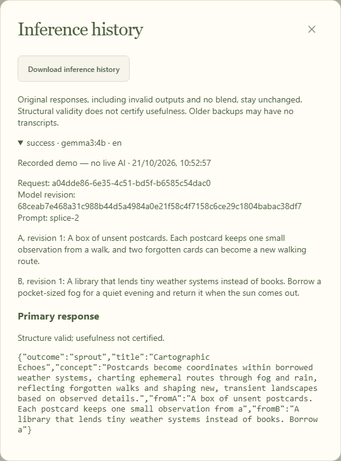

# Save limits and garden recovery

Every accepted write is checked against the same validation and JSON budget used by backup export and restore. A rejected write leaves the previous save intact. Originals are preserved without silent trimming.

| Limit                                | Value                                     |
| ------------------------------------ | ----------------------------------------- |
| Normalized scrap                     | 8–800 Unicode characters                  |
| Original scrap, including whitespace | 8 KiB of UTF-8                            |
| Scraps                               | 200                                       |
| Saved text revisions per scrap       | 100, including the current raw input      |
| Sprouts                              | 1,000                                     |
| Pairing records                      | 19,900                                    |
| Inference transcripts                | 100 runs, at most two returned responses per run |
| Portable JSON backup                 | 2 MiB, including indentation and metadata |

The total byte budget can be reached before a record-count limit. Writes reserve enough space for the longest valid revision counter, so crossing a revision digit boundary does not break an otherwise unchanged backup. Export uses the same pretty-printed serialization as the write check. The UI reports an error before replacing the saved state when a change exceeds a limit.

## If a saved garden cannot open

An invalid, future-version or oversized record opens a recovery screen. The stored record remains intact.

1. Select **Download original record** to keep the complete stored value as JSON. This raw recovery file may need repair or exceed the normal import limits; it is not certified as a valid backup.
2. Choose a valid JSON backup for the same garden. Validation completes before a replacement preview appears. The sample and personal records are independent.
3. Review the scrap/sprout counts, then explicitly confirm replacement, or select **Cancel restore**.
4. On confirmation, one IndexedDB transaction preserves the old record under a separate recovery key and installs the validated garden. If the record changed in another tab or the transaction aborts, replacement fails without changing the old record.
5. **Backup and export → Download previous recovery copy** retrieves that preserved original, including after reload. A later confirmed recovery replaces this one previous copy; download it separately for longer retention. Normal garden backups contain the active garden, not the separate recovery copy.

You can also open the independent garden or reload recovery. A competing writer tab must be closed before restoring. Recovery does not execute or resume model calls. The app does not automatically reset, migrate or truncate an unreadable record.

Raw downloads may contain all of your original ideas. Keep them private; use fictional inputs in public bug reports.

## Inference history and normal restore

**Backup and export → Inspect inference history** shows unchanged primary/repair responses, validation errors, no_blend reasons, cancellations, model/prompt/language identity and the exact parent revisions. Download the transcript JSON or include it in the normal garden backup. Markdown quotes each raw response as a JSON string, preserving its original characters. The history is separate from the per-pair attempt index, so retrying a failed pair does not overwrite earlier responses. Legacy v1 backups without transcripts remain readable; missing historical responses are not invented.

Each response is committed before requesting a repair. A new run needs 192 KiB of backup headroom and one of the 100 transcript records; reaching a limit blocks generation before a model call. Export history before removing a source; the deletion preview counts dependent transcripts as well as sprouts. The normal 2 MiB save check still applies to every write.

After an error, cancellation, no_blend or interrupted reload, **Try an unfinished pairing** remains in the garden. Inspect its two sources, choose a pair if several are available, reconnect your chosen local engine if needed, and select **Retry this pairing**. Reload never starts inference automatically. Retrying creates a new request and retains earlier responses. Editing or deleting a parent invalidates the old retry; a successful pair cannot be spent again. Legacy backups can recover failed pair choices from their pairing records without reconstructing missing model responses.

The add form keeps its draft when a scrap or sprout editor is saved or dismissed. **Collection → All discoveries** retains access to earlier unkept results; the **Kept ideas** filter remains available. Restoring a backup accepts identical output fields regardless of JSON property order, while still validating every value against the unchanged original response.

**History** on a scrap shows every retained raw/text revision, even if no sprout has used it. JSON backups and Markdown include the saved source history; a separate download contains that source only. Revisions preserve the actual submitted Unicode spelling and whitespace. Browser textareas normalize line endings before submission; imported raw strings are retained exactly as supplied. Existing sprout snapshots are unchanged by later edits. A source can retain 100 revisions including the current value, under the same total 2 MiB budget. A rejected edit leaves the saved source and its history intact; nothing is silently trimmed. An unchanged edit does not create a new revision.

Legacy v1 records may have no earlier raw text. They remain valid; the history identifies the first known revision and explicitly discloses missing predecessors. Editing such a source starts retaining from the currently available revision without reconstructing older originals. Removing a source also removes its history under the existing cascade preview, which now counts saved text revisions. There is no hidden prune-history operation.

Keyboard skip moves focus to the main content without replacing the selected-garden hash or adding a browser history entry. Back/forward navigation restores the selected garden. Idle slots and distinct combinations have separate counts; exhausted sources disable ordinary growth without spending slots. Failed pairs remain explicit retries. Pair selection indexes attempted keys before scanning; retry menus render 50 choices per page so all 19,900 supported legacy pairing records remain reachable without a giant select.

A new pair also needs a free pairing-history record. At 19,900 records, starting a new key is rejected before a pending request is saved or a model is called; retries of an existing failed key remain possible. The UI explains the limit and opens a cascade preview if you choose to review a source for removal. This preview counts pairing records as well as text revisions, results and transcripts. Download a backup before confirming deletion if you want to retain them. No older record is silently pruned to create space.

An unexpectedly large response that cannot fit is retained under a separate inference recovery key, and can be downloaded from Backup and export after reload. It is outside the normal garden backup. Further generation is blocked until this copy is handled. Removing it requires a preview and explicit confirmation. If IndexedDB itself rejects the recovery write (for example, disk quota exhaustion), the page keeps the response in memory and explicitly asks for download before closing; persistence cannot be promised when storage rejects all writes.

Normal backup restore compares the locally previewed revision in both IndexedDB and memory mode. A stale preview or subsequent stale writer is rejected even without Web Locks. Successful replacement advances the current local revision and atomically retains the replaced garden as **Download before-restore copy**. A later normal restore replaces that one copy. The damaged original retained by startup recovery is separate and remains available as **Download previous recovery copy**.

## Regression verification

From the repository root with Node 24 / npm 11:

```sh
npm run verify
npm run build
npm run package:single
npx playwright install chromium
npm run test:recovery
npm run test:p1
```

The dedicated Chromium suite uses isolated contexts and fictional IndexedDB fault injection. It checks corrupt, unsupported-version and oversized records in both the production static build and the standalone HTML with network disabled; rejected imports, cancellation, explicit replacement, raw downloads, recovery-copy retention, reload, ordinary backup roundtrip, a changed-record conflict, independent-garden access, mobile width and rejected new input. It does not use a model or an inference substitute. The recovery tests also run in repository CI, independently of live Ollama tests.

Unit regressions additionally cover original UTF-8 byte limits, a boundary-sized pretty backup across revision 9 → 10, accumulated history/count limits, memory fallback, preserved pending requests and an aborted recovery transaction.

`test:p1` runs nineteen Chromium cases. Seven transport/storage cases check invalid primary/repair, no_blend, transport failure, cancellation, explicit retries after reload, oversized response recovery, and stale normal restore/saves without Web Locks. Four workflow cases check independent drafts across Escape/close/backdrop/save/validation, two-result discovery navigation and immutable model text when JSON properties are reordered. Eight stability cases cover production/offline source originals and cascade previews, legacy disclosure/count limits, skip/back/forward behavior, 2/3/200-source exhaustion and paged retry interaction with 19,900 attempts. They use fictional inputs, exact labelled public recordings, synthetic pairing indexes or an explicitly labelled loopback transport stub. Synthetic indexes and stub responses are not live model evidence. Repository CI runs this suite independently of real Ollama acceptance.



Actual Chromium capture from the updated UI. The example is visibly recorded, not a new model call. [Fresh live acceptance](../evidence/p1-verification.json) separately preserves two actual local 1B outputs and the measured runtime/build identities. A prior live attempt returned a token-repeat error; its [unchanged HTTP error and public fictional inputs](../evidence/model/p1-live-failure.json) remain available, with missing model text explicitly null.

The [sanitized local verification record](../evidence/recovery-verification.json) lists the final file hashes, standalone hash and executed browser cases. The [recovery screenshot](../evidence/recovery.png) shows the explicit replacement preview using fictional data. Historical live-model acceptance remains separate.
